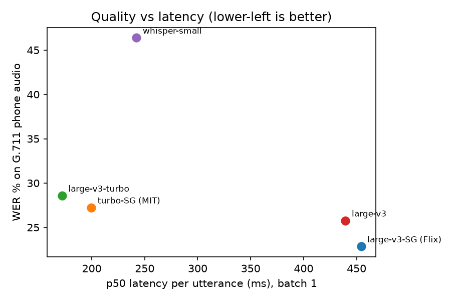
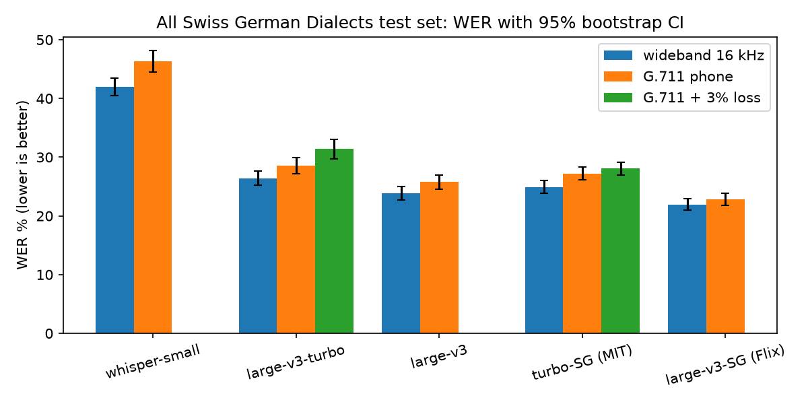

# Swiss German STT on the phone: where do numbers break?

A one-day benchmark of open Whisper checkpoints on **Swiss German speech → Standard German text**,
measured the way a phone voice agent hears it: **G.711 narrowband audio**, with a focus on
**numbers** (amounts, dates, votes, IDs), which callers dictate and which an agent must get right.

## Key findings

1. **Swiss German fine-tunes make fewer word errors but more number errors.** On spontaneous
   parliamentary speech over a G.711 line, both fine-tuned checkpoints get numbers wrong more often
   than the base model they started from:

   | model | WER % ↓ | number errors % ↓ [95% CI] | vs. its base model, pts [95% CI] |
   |---|---|---|---|
   | large-v3 (base) | 19.9 | **8.4** [5.5, 11.7] | |
   | large-v3-SG (Flix) | 32.8 | 13.1 [9.6, 16.6] | **+4.8** [1.4, 8.0] |
   | large-v3-turbo (base) | 22.6 | 10.6 [7.9, 13.6] | |
   | turbo-SG (MIT) | **18.2** | 17.3 [13.7, 20.6] | **+6.7** [3.3, 9.9] |

   The turbo fine-tune gains 4.4 WER points and loses 6.7 points on numbers. Two independent fine-tunes
   show the same direction, so it is unlikely to be a quirk of one checkpoint. Typical failures:
   `3700` → "dreitausendsebhundert", `2022 bis 2025` → "2020 bis 25", `2021` → "2020".
   *Number errors here exclude numbers lost in skipped passages (finding 4), which is a long-form
   decoding problem rather than a number problem.*
   **Choosing an STT model on WER alone would pick the model that is worse at amounts and dates.**

2. **The phone line costs 1–4 WER points, and the best model is also the most robust.**
   On the dialect test set (the cleanest comparison), G.711 adds +2.0 to +2.3 points for large-v3,
   large-v3-turbo and turbo-SG, +4.4 for whisper-small, and only +0.9 [0.6, 1.2] for the Flix full
   fine-tune, which is the best model overall (22.8 % WER on phone audio).
   3 % packet loss adds another +2.8 points for large-v3-turbo but only +0.8 for turbo-SG.

3. **Dialect matters more than the codec.** Valais German is the outlier for every model
   (29.5–59.8 % WER on the phone line versus 20.9–42.8 % for Zürich). St. Gallen sits in the middle
   (Flix: 22.6 % [21.0, 24.2]).

4. **Long audio gets skipped, not just misheard.** With 30 s chunked decoding, 5–17 % of reference
   numbers disappear inside passages of ≥ 5 dropped words; Flix is the worst (its parliament WER
   rises by 5.8 points on the phone line). Short, VAD-segmented turns, as in a live call, should
   avoid most of this, but it matters for voicemail or call summaries.

5. **Forcing `language="de"` breaks on French.** 45 of 429 Bern parliament segments are in French.
   Forced to German, the models translate badly or loop ("Herr Präsident, Herr Präsident, …").
   Bilingual cantons (BE, FR, VS) need per-turn language ID.

6. **Latency on one consumer GPU (RTX 5070, batch 1, 8 s utterances):** large-v3-turbo 172 ms p50,
   turbo-SG 200 ms, whisper-small 242 ms, large-v3 440 ms, Flix 454 ms.
   Turbo models are 2.3–2.6× faster than large-v3 models for 3–4.5 more WER points on phone audio.




## What I would do next for a production phone agent

- **Track a slot metric, not only WER**: number/date/name accuracy per turn, in the eval harness.
- **Confirm critical slots** ("Ich habe 3700 Franken verstanden, stimmt das?"), or route turns where the
  agent just asked for a number to the checkpoint that is best at numbers.
- **Fine-tune with number-dense Swiss German data and one consistent number format in the targets.**
  A Swiss German TTS can synthesise dictated amounts, dates, phone numbers and IDs at scale; the
  "dreitausendsebhundert" errors suggest inconsistent number formatting in the training targets.
- **Per-turn language ID** before STT for bilingual regions.
- **Test on real calls**: real handsets, background noise and caller hesitation are not simulated here.

Full tables: [`results/summary.md`](results/summary.md).

## Setup

**Test sets** (both public, Swiss German audio with Standard German references)

| set | content | size | why |
|---|---|---|---|
| [All Swiss German Dialects Test Set](https://www.cs.technik.fhnw.ch/i4ds-datasets) (FHNW/i4ds, MIT) | read Common Voice sentences, speaker canton labelled | 5,750 clips, 178 speakers, 12.7 h | dialect coverage close to the real distribution (770 clips from St. Gallen) |
| [SPC_R test](https://huggingface.co/datasets/i4ds/spc_r) (i4ds, CC BY 4.0) | spontaneous debate, Grosser Rat Bern | 384 German segments ≤ 120 s (45 French ones excluded), 5.8 h | dense in amounts, votes, dates, article numbers |

**Channel conditions** ([`sgbench/telephone.py`](sgbench/telephone.py))

- `wide`: original 16 kHz audio
- `phone`: 300–3400 Hz band-pass → 8 kHz → ITU-T G.711 µ-law (exact tables) → back to 16 kHz
- `phone_loss3`: as `phone` plus 3 % dropped 20 ms RTP frames without concealment (worst case)

**Models**: `openai/whisper-small`, `openai/whisper-large-v3`, `openai/whisper-large-v3-turbo`,
`gcoli/whisper-large-v3-turbo-swiss-german-mit` (LoRA on SPC, MIT licence),
`Flix-AI/flix-swissgerman-full` (full fine-tune incl. SPC_R train, Apache-2.0).
All decoded greedily in fp16 with `language="de"`, Hugging Face `transformers`, on one RTX 5070 (12 GB).
Licences matter for a product: several popular Swiss German checkpoints are CC BY-NC and were left out.

**Metrics** ([`sgbench/metrics.py`](sgbench/metrics.py))

- **WER** after normalisation (lower-case, punctuation removed, ß → ss) and **number canonicalisation**:
  `75'000`, `75.000` and `fünfundsiebzigtausend` all become `75000`, `drei` becomes `3`
  ([`sgbench/numbers_de.py`](sgbench/numbers_de.py)). Without this, Whisper's digit/word choice
  inflates WER for reasons a downstream LLM does not care about.
- **BLEU** (sacreBLEU), the usual metric for Swiss German → Standard German, since the task is partly
  translation. Reported only as a cross-check: it ranks the models the same way as WER, so the ranking
  does not hinge on WER penalising valid rephrasings. No confidence interval.
- **Number recall / precision**: the numbers in the reference and hypothesis as multisets; recall = share
  of reference numbers that appear in the hypothesis.
- **95 % confidence intervals by bootstrap.** On the dialect set the resampling unit is the **speaker**
  (cluster bootstrap): clips from one speaker are correlated, so resampling clips would give intervals
  that are too narrow. Phone-vs-wideband differences use a **paired** bootstrap on the same resamples.
- **Latency**: 200 phone clips, batch size 1, wall-clock from audio to text (feature extraction + greedy
  decoding), p50/p90/p99 and real-time factor.

## Caveats

- Read speech (dialect set) and parliamentary speech (SPC_R) are not phone calls: no real handset
  microphones, background noise or caller hesitation. The phone condition models the codec, not the acoustics.
- Both fine-tuned models saw Bern parliament data in training (SPC / SPC_R train). SPC_R test is a held-out
  split, but same parliament and partly same speakers, so their SPC_R numbers are optimistic.
  The dialect set is the cleaner comparison.
- SPC_R has no speaker ids, so its bootstrap resamples segments; one MP can appear in several
  segments, so those intervals are probably somewhat too narrow.
- The number normaliser handles digits, Swiss thousand separators, cardinal words and "zweimal",
  but not numbers inside compounds ("Dreijahresvertrag"); those count as misses for every model alike.
- Whisper is not a streaming model; batch-1 latency is a proxy for the delay after end of turn.
- One run, greedy decoding, no prompt or hotword biasing.

## Reproduce

```bash
python -m venv .venv
.venv/Scripts/python -m pip install torch torchaudio --index-url https://download.pytorch.org/whl/cu128
.venv/Scripts/python -m pip install transformers accelerate pandas pyarrow soundfile scipy numpy sacrebleu jiwer matplotlib
# data (not in the repo):
#   FHNW "All Swiss German Dialects Test Set" zip -> unzip into data/asgdts, then untar clips.tar there
#   https://huggingface.co/datasets/i4ds/spc_r/resolve/main/data/test-00000-of-00001.parquet -> data/spc_r_test.parquet
bash run_all.sh        # ~3 h on an RTX 5070, resumable
.venv/Scripts/python analyze.py
```
